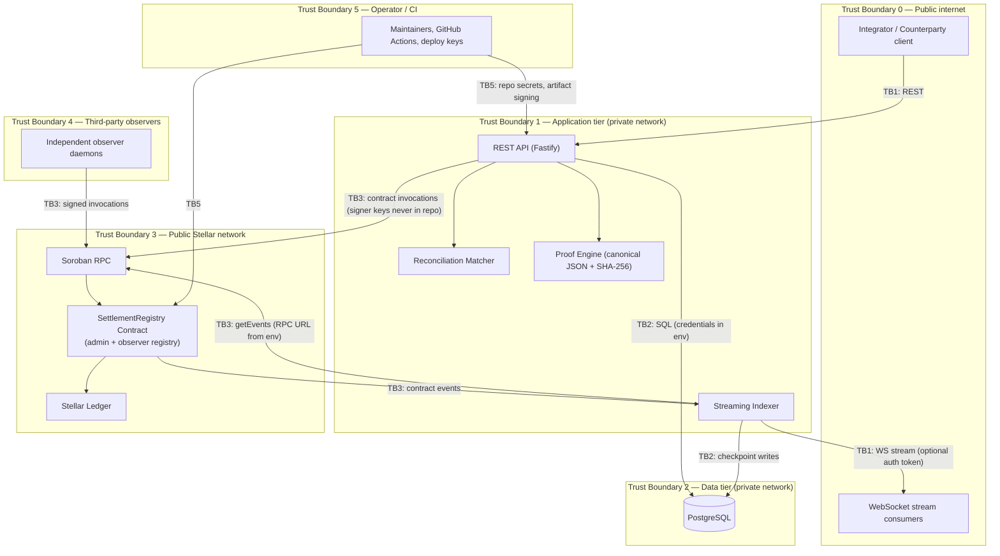

# StellarClear Threat Model (STRIDE)

**Status:** Living document — v0.1.1, last reviewed 2026-10-08.
**Framework:** STRIDE, per the [Threat Modeling Readiness How-To Guide](https://developers.stellar.org/docs/build/security-docs/threat-modeling).
**Companion document:** [Monitoring Plan](./monitoring-plan.md) — every threat here carries at least one monitor (`<ThreatID>.M.<n>`) or a documented reason it cannot be monitored on-chain.

---

## 1. Scope

**In scope**

| Component | Location |
| :--- | :--- |
| `SettlementRegistry` Soroban contract | `stellarclear-contract/contracts/settlement-registry/src/` (`lib.rs`, `auth.rs`, `storage.rs`, `types.rs`, `events.rs`, `errors.rs`) |
| REST API service | `stellarclear-app/services/api` |
| Reconciliation matcher | `stellarclear-app/services/matcher` |
| Streaming indexer + WebSocket stream | `stellarclear-app/services/indexer` |
| Proof / commitment package (RFC 8785 + SHA-256) | `stellarclear-app/packages/proof` |
| Persistence layer | `stellarclear-app/packages/db` (PostgreSQL) |
| Client SDK | `stellarclear-app/packages/sdk` |
| Release artifacts & CI | `artifacts/` (pinned WASM), `.github/workflows/` |

**Out of scope:** Stellar Core consensus and Soroban host internals, `soroban-sdk` and compiler internals, third-party Stellar wallets/infrastructure, end-user device security.

---

## 2. System dataflow & trust boundaries

### Data entities

| Entity | Where it lives | Sensitivity |
| :--- | :--- | :--- |
| Trade terms (parties, amounts, references) | Off-chain only (owner DB / API), **never on-chain** | Confidential |
| SHA-256 commitments (`terms`, `observation`, `dispute`, `resolution`) | On-chain (`BytesN<32>`) | Public, by design |
| Observed Stellar tx hashes + ledger sequence | On-chain | Public |
| Attestations (role, commitment, ledger, attestor address) | On-chain | Public |
| Case lifecycle status + break codes | On-chain | Public |
| `SettlementProof` bundles | Off-chain export, verifiable offline | Confidential payload, public verifiability |
| Observer/admin signing keys | Observer & operator custodians (never in repo) | Critical |
| API/DB/RPC configuration | Environment variables (`.env`, never committed) | Critical |

---

## 3. Actors & trust assumptions

| Actor | Trust level | Assumption |
| :--- | :--- | :--- |
| Contract admin | Trusted, minimal power | Admin key adds/removes observers only; cannot mutate case state |
| Case owner / counterparty | Semi-trusted | Each `require_auth()`ed for their own actions; both must agree to resolve |
| Registered observers | Semi-trusted, M-of-N | Honest-majority within the configured quorum; individually may be malicious |
| Integrators (API clients) | Untrusted | v0.1.1 API relies on **network-level isolation** (no end-user authn — see Spoof.2) |
| Indexer/RPC endpoint | Semi-trusted | Availability-dependent; events verified against DB constraints |
| Maintainers / CI | Trusted | Repo secrets, artifact pinning |

**Core cryptographic assumption:** SHA-256 preimage/collision resistance over RFC 8785 canonical JSON.

---

## 4. STRIDE threat register

Severity: **Critical / High / Medium / Low**. Remediations are referenced as `<ThreatID>.R.<n>`; monitors as `<ThreatID>.M.<n>` (defined in the [Monitoring Plan](./monitoring-plan.md)).

### 4.1 Spoofing

| ID | Threat | Component | Severity | Mitigation / remediation | Status |
| :--- | :--- | :--- | :--- | :--- | :--- |
| Spoof.1 | A stolen observer key submits false observations, matches, or breaks | Contract, observer ops | High | `require_observer_auth()` + admin-curated registry; M-of-N quorum means one compromised observer cannot finalize. **Spoof.1.R.1**: observer key-custody policy (HSM/multisig per observer org). **Spoof.1.R.2**: keep quorum ≥ 2 per case. | Partially mitigated (design); key custody is observer-side |
| Spoof.2 | An attacker calls REST endpoints as a legitimate counterparty (case creation, observation, attestation requests) | API | High | v0.1.1 has **no end-user authentication layer**; deployment assumes private-network exposure only. **Spoof.2.R.1**: API-key/mTLS authentication before mainnet. **Spoof.2.R.2**: never expose API publicly; bind to private network. | Open — mainnet blocker |
| Spoof.3 | An unauthorized client subscribes to the WebSocket state stream | Indexer WS | Medium | Stream binds to localhost by default; optional `INDEXER_STREAM_AUTH_TOKEN`. **Spoof.3.R.1**: require token + TLS (`wss://`) for any non-local exposure. | Mitigated by default config |
| Spoof.4 | A party is tricked into signing a commitment for the wrong case (display/UX spoofing) | SDK, integration UX | Low | Contract binds commitment to `case_id`; SDK exposes typed case data. **Spoof.4.R.1**: integrators must display commitment preimages before signing. | Mitigated on-chain; UX-dependent |

### 4.2 Tampering

| ID | Threat | Component | Severity | Mitigation / remediation | Status |
| :--- | :--- | :--- | :--- | :--- | :--- |
| Tamper.1 | Unauthorized mutation of on-chain case state | Contract | Low | All mutating entrypoints guard with `require_admin_auth` / `require_observer_auth` / principal `require_auth()`; terminal immutability rejects all mutation after `Finalized` (`Error::InvalidState`); no admin override of case data exists. | Mitigated (adversarial test matrix) |
| Tamper.2 | Weak/zero commitments enabling forged evidence | Proof pkg, contract | Low | `require_non_zero_commitment()` on every commitment; RFC 8785 canonicalization; SHA-256. | Mitigated |
| Tamper.3 | Replay of an attestation or observation across cases | Contract | Medium | Storage keys are case-scoped; `AttestationAlreadyExists` + distinct-observer dedup; owner/counterparty/observer role separation enforced. | Mitigated (replay test suite) |
| Tamper.4 | Off-chain DB diverges from or is altered relative to chain state | DB, indexer | Medium | Idempotent insert guards, cursor checkpoints, DB constraints; `POST /v1/proofs/verify/onchain` re-anchors proofs to live contract state. **Tamper.4.R.1**: periodic chain-vs-DB reconciliation job. | Partially mitigated |
| Tamper.5 | Substituted contract WASM at deploy/release time | Release pipeline | Low | Reproducible builds, pinned SHA-256 (`0073a4cb…`), `verify-artifact.sh` byte-for-byte check in CI (`security-verification.yml`, `release-verification.yml`), release manifest in `artifacts/`. | Mitigated |

### 4.3 Repudiation

| ID | Threat | Component | Severity | Mitigation / remediation | Status |
| :--- | :--- | :--- | :--- | :--- | :--- |
| Repud.1 | A party denies submitting an attestation, dispute, or resolution | Contract | Low | Signed invocations with `require_auth()`; typed events record attestor/resolver address + ledger; `SettlementProof` bundles are offline-verifiable. | Mitigated |
| Repud.2 | An observer denies having recorded a false match/break | Contract | Low | Events (`CaseMatched`, `CaseBroken`) permanently record the observer address. | Mitigated |
| Repud.3 | API-originated actions cannot be attributed to an identity | API | Medium | Only request-level logs + idempotency keys exist; ties to Spoof.2. **Repud.3.R.1**: authenticated, logged API actions before mainnet. | Open — mainnet blocker |

### 4.4 Information Disclosure

| ID | Threat | Component | Severity | Mitigation / remediation | Status |
| :--- | :--- | :--- | :--- | :--- | :--- |
| Info.1 | Trade terms or counterparties leak from the chain | Contract, proof | Low | Only SHA-256 commitments and public tx references are anchored; raw terms stay off-chain (architectural principle #1). | Mitigated by design |
| Info.2 | Credentials leak via the repository or CI | Repo, CI | Critical | Repo-wide secret scan clean (2026-10-08: no PATs, private keys, or cloud keys in tracked files); config via environment only; `.env.example` contains placeholders/testnet values. **Info.2.R.1**: rotate any credential ever shared in chat/plaintext; enable secret scanning + push protection on GitHub. | Verified; rotation noted as operational action |
| Info.3 | Eavesdropping on the WebSocket settlement stream | Indexer WS | Medium | Localhost default + optional auth token; **Info.3.R.1**: TLS (`wss://`) whenever exposed beyond localhost. | Mitigated by default config |
| Info.4 | Database or API exposed by misconfiguration (e.g., public port mapping) | Deployment | Medium | Docker Compose private topology; ops guide restricts exposure. **Info.4.R.1**: never publish the Postgres port; place API behind private network/mTLS. | Config-dependent |

### 4.5 Denial of Service

| ID | Threat | Component | Severity | Mitigation / remediation | Status |
| :--- | :--- | :--- | :--- | :--- | :--- |
| DoS.1 | Soroban RPC outage or rate-limiting stalls ingestion | Indexer | Medium | Durable cursor checkpoints and replay-safe reconnection; **DoS.1.R.1**: exponential backoff with jitter (tracked, Issue #19). | Partially mitigated |
| DoS.2 | On-chain case state is archived (TTL expiry) and becomes unreachable | Contract storage | High | **Open finding:** current code performs no `extend_ttl` on persistent case records; long-dormant cases risk state-archival before mainnet. **DoS.2.R.1**: TTL extension/restoration strategy + archival monitoring before mainnet. | Open — mainnet blocker |
| DoS.3 | Request floods or oversized payloads exhaust the API | API | Medium | Zod strict validation, payload and idempotency-key bounds; **DoS.3.R.1**: rate limiting + request-size caps at the reverse proxy. | Partially mitigated |
| DoS.4 | Parties stall a dispute indefinitely | Contract | Low | Ledger-bounded dispute TTL (`120–518,400` ledgers, default ~24 h) with permissionless `expire_dispute` returning the case to `Break` — never forging agreement. | Mitigated by design |

### 4.6 Elevation of Privilege

| ID | Threat | Component | Severity | Mitigation / remediation | Status |
| :--- | :--- | :--- | :--- | :--- | :--- |
| Elev.1 | Compromised admin key manipulates the observer registry (adds a malicious observer) | Contract | High | Admin power is scoped to `add_observer`/`remove_observer` only — no case-data mutation, no overrides. **Elev.1.R.1**: multisig/Guarded admin before mainnet (documented known limitation). **Elev.1.R.2**: alert on any registry change. | Partially mitigated |
| Elev.2 | Finalization with an effectively single-observer quorum | Contract | High | Default `quorum = 1` for backwards compatibility means a **lone observer can satisfy quorum** unless configured. **Elev.2.R.1**: require `set_case_quorum ≥ 2` as deployment policy for mainnet cases. **Elev.2.R.2**: monitor every `CaseQuorumSet`. | Open — mainnet blocker |
| Elev.3 | An attestation from a later-revoked observer still counts toward quorum | Contract | Medium | Historical attestation validity is intentional (evidence integrity), but revocation does not undo past attestations. **Elev.3.R.1**: on `ObserverRemoved`, review the observer's outstanding attestations against quorum. | Accepted by design; detection required |
| Elev.4 | Owner/counterparty attempts to count themselves as observers | Contract | Low | Explicitly rejected in both attestation paths (`observer == owner` / `== counterparty` → `Unauthorized`). | Mitigated (adversarial tests) |

---

## 5. Residual risk summary (open items)

| ID | Open item | Blocking for |
| :--- | :--- | :--- |
| Spoof.2 / Repud.3 | API has no end-user authentication | Mainnet launch |
| DoS.2 | Contract TTL/archival management absent | Mainnet launch |
| Elev.2 | Default quorum of 1 requires explicit ≥2 policy | Mainnet launch |
| Elev.1.R.1 | Admin multisig | Mainnet launch |
| DoS.1.R.1 | Indexer backoff/jitter (Issue #19) | v0.2.0 |
| Tamper.4.R.1 | Periodic chain-vs-DB reconciliation | v0.2.0 |

## 6. Review cadence

Re-review this model whenever: a contract function or state transition changes; a new service/endpoint is added; a deployment boundary changes (e.g., public API exposure); or after any audit finding. The [Monitoring Plan](./monitoring-plan.md) must be updated in the same change.
